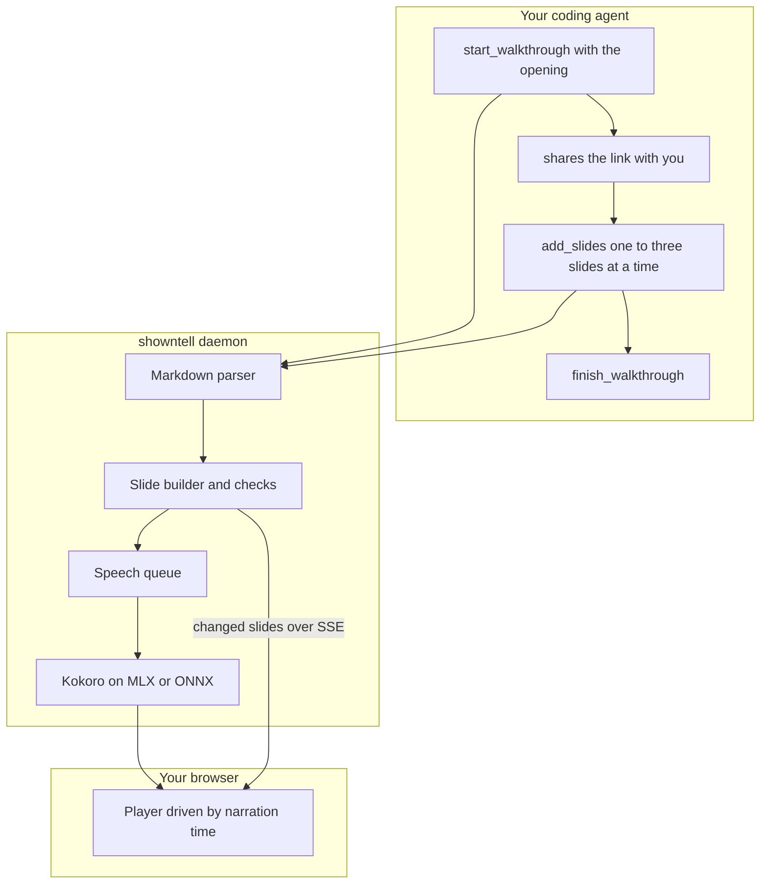

# showntell

Narrated slide walkthroughs for coding agents, voiced on your machine.

Ask your agent to walk you through a pull request, a module or a concept. It writes slides and narration in Markdown; showntell voices them locally with [Kokoro](https://huggingface.co/hexgrad/Kokoro-82M) and hands back a link that starts playing in about a second, while the rest is still being written. A pointer follows the narration through code, diagrams and lists, word by word.


**[Watch the gallery](https://rahimnathwani.github.io/showntell/)**: ten walkthroughs written by Claude (Opus and Sonnet) and voiced on a laptop, unedited: a tour of this repository, one call's path through it, a refactor step by step, a code review, contributor setup, a speed-up told with a chart, the messages of an MCP tool call, the TLS 1.3 handshake, scaled dot-product attention, and git rebase versus merge on a phone-shaped frame.

- **Local:** speech runs on your Mac or PC. No API keys, no hosted service, no telemetry. Code never leaves your machine except to the model you already use.
- **Fast:** the link is playable about 0.3 s after the agent sends its opening, so you start watching while the agent keeps writing.
- **Grounded:** code slides are read straight from your files and git history, with real line numbers. The agent never retypes code, and the pointer lands on the right line.
- **Checked:** every call returns coded findings to the agent: a cue pointing at a missing line, code too big for the frame, narration that reads the screen aloud, a slide that holds still too long, and, from the player, diagrams that failed to render or text shrunk too small to read; with Playwright installed, `finish_walkthrough` draws every slide to find them. The agent can also look at pictures of its slides with `preview_slides`.
- **Shareable:** export a walkthrough as one HTML file that plays offline (send it in Slack or by email), a static folder with captions, or an MP4; embed it with `<showntell-player>`, link to a range of slides, or present it yourself with speaker notes. An agent in a sandbox or behind WhatsApp sends you the MP4 itself.

How it compares with a screen recording, a written PR description and a rendered MP4 explainer, including where those win: [docs/comparison.md](docs/comparison.md).

## Install

You need [uv](https://docs.astral.sh/uv/). It installs Python 3.12 or newer for you if needed.

Every agent runs the same command, which starts showntell as a stdio MCP server:

```zsh
uvx --from git+https://github.com/rahimnathwani/showntell@v0.2.2 showntell mcp
```

The tag after `@` installs that release; leave it off for the latest commit. Once showntell is on PyPI this shortens to `uvx showntell mcp`. Pick your agent below, then ask it something like *"walk me through how a request gets retried in this codebase"*. The agent replies with a link; open it and press play.

The first run downloads the voice model (about 330 MB on Apple silicon, 92 MB elsewhere) and a 12 MB English language model. The first walkthrough takes a few seconds longer while they load. After that, everything works offline.

The base install leaves out the browser that draws slides. With it, `finish_walkthrough` checks every slide's layout and shows the agent pictures of slides that look alike, each walkthrough gets a poster in the gallery, and MP4 export works. To add it, use the `video` extra in place of the command above and fetch Chromium (about 100 MB) once:

```zsh
uvx --from 'showntell[video] @ git+https://github.com/rahimnathwani/showntell@v0.2.2' showntell mcp
uvx --from 'showntell[video] @ git+https://github.com/rahimnathwani/showntell@v0.2.2' playwright install chromium
```

`showntell doctor` says whether the browser was found. Without it, finish tells the agent the slides were not drawn.

Or paste this into your agent and let it set itself up:

```text
Install showntell, an MCP server that turns Markdown into narrated slide walkthroughs voiced on this machine: https://github.com/rahimnathwani/showntell

1. If `uv` is missing, install it: curl -LsSf https://astral.sh/uv/install.sh | sh
2. Add a stdio MCP server named showntell to your own MCP configuration, for all my projects, with this command:
   uvx --from git+https://github.com/rahimnathwani/showntell@v0.2.2 showntell mcp
3. Run `uvx --from git+https://github.com/rahimnathwani/showntell@v0.2.2 showntell doctor` and fix anything it marks with ✗. The first run downloads the voice model, a few hundred MB.
4. Tell me whether I need to restart you or reload MCP servers before the tools appear. Once they do, make a three-slide walkthrough of this project and send me the link.
```

### Claude Code

1. Add the server for all your projects:

   ```zsh
   claude mcp add --scope user showntell -- uvx --from git+https://github.com/rahimnathwani/showntell@v0.2.2 showntell mcp
   ```

2. Start a new `claude` session and run `/mcp`; `showntell` should be listed as connected.
3. Ask for a walkthrough, or use a built-in prompt: `/mcp__showntell__diff HEAD~1..HEAD`, `/mcp__showntell__file src/app.py` or `/mcp__showntell__topic how TLS works`.

**Or install the plugin** instead of step 1. You get the MCP server plus a skill: guidance on when a walkthrough beats a written answer, and how to pace one:

```zsh
claude plugin marketplace add rahimnathwani/showntell
claude plugin install showntell@showntell
```

Claude Code 2.1.275 or later does both in one step: `claude plugin install showntell --marketplace rahimnathwani/showntell`. Check it with `claude plugin list`. A new release arrives with `claude plugin marketplace update showntell` and then `claude plugin update showntell@showntell`. Use the plugin or `claude mcp add`, not both, or Claude sees two copies of the tools.

### Codex CLI

1. Add the server (this writes `~/.codex/config.toml`):

   ```zsh
   codex mcp add showntell -- uvx --from git+https://github.com/rahimnathwani/showntell@v0.2.2 showntell mcp
   ```

2. Check it with `codex mcp list`, or run `/mcp` inside a `codex` session.
3. Start `codex` in your project and ask for a walkthrough.

If you prefer to edit the config file yourself, add:

```toml
[mcp_servers.showntell]
command = "uvx"
args = ["--from", "git+https://github.com/rahimnathwani/showntell@v0.2.2", "showntell", "mcp"]
```

### Antigravity CLI (agy)

1. Add the server (this writes `~/.gemini/config/mcp_config.json`, which the Antigravity IDE shares). Flags go before the name, and the `--` keeps `--from` from being read as an agy flag:

   ```zsh
   agy mcp add showntell -- uvx --from git+https://github.com/rahimnathwani/showntell@v0.2.2 showntell mcp
   ```

2. Check it with `agy mcp list`.
3. Start `agy` in your project and ask for a walkthrough. MCP tools ask for approval by default, so allow showntell's tools when prompted. In print mode there is no prompt, so the calls may be refused.

### Gemini CLI

1. Install the extension. It adds the server and a context file with the same guidance as the Claude Code skill:

   ```zsh
   gemini extensions install https://github.com/rahimnathwani/showntell
   ```

2. Check it with `gemini extensions list`, or run `/mcp` inside a `gemini` session.
3. Start `gemini` in your project and ask for a walkthrough. Update later with `gemini extensions update showntell`.

### Pi

Recent Pi (checked with 1.3.0) has MCP built in.

1. Add the server (this writes `~/.pi/agent/mcp.json`; add `-l` to write `.pi/mcp.json` in the current project instead):

   ```zsh
   pi mcp add showntell -- uvx --from git+https://github.com/rahimnathwani/showntell@v0.2.2 showntell mcp
   ```

2. Check it with `pi mcp list`. It should say `showntell: connected, 7 tools`.
3. Start `pi` in your project and ask for a walkthrough.

Older Pi without `pi mcp` needs the [pi-mcp-adapter](https://github.com/nicobailon/pi-mcp-adapter) extension instead. Run `pi install npm:pi-mcp-adapter`, then put this in `~/.config/mcp/mcp.json`:

```json
{
  "mcpServers": {
    "showntell": {
      "command": "uvx",
      "args": ["--from", "git+https://github.com/rahimnathwani/showntell@v0.2.2", "showntell", "mcp"]
    }
  }
}
```

### Other clients

- **VS Code:** add the server to your user profile from a terminal, then pick `showntell` under **MCP: List Servers**:

  ```zsh
  code --add-mcp '{"name":"showntell","command":"uvx","args":["--from","git+https://github.com/rahimnathwani/showntell@v0.2.2","showntell","mcp"]}'
  ```

- **GitHub Copilot CLI:** its plugin system reads the same marketplace file as Claude Code: `copilot plugin marketplace add rahimnathwani/showntell`, then `copilot plugin install showntell@showntell`.
- **Cursor, Claude Desktop and others:** add a stdio server with command `uvx` and arguments `--from git+https://github.com/rahimnathwani/showntell@v0.2.2 showntell mcp`. Most use the same `mcpServers` JSON as the older-Pi example.
- **Over HTTP:** run `uvx --from git+https://github.com/rahimnathwani/showntell@v0.2.2 showntell serve` and connect the client to `http://localhost:4747/mcp`.

### Agents in a sandbox or a chat app

When the agent runs in a sandbox, or you talk to it through WhatsApp, Telegram or similar, a `localhost` link is no use to you. Run the server with `--deliver file`: the agent then writes the whole walkthrough, calls `export_walkthrough`, and sends you the MP4 instead of a link.

```zsh
# inside the sandbox image, once (Debian or Ubuntu)
apt-get install -y ffmpeg
uvx --from 'showntell[video] @ git+https://github.com/rahimnathwani/showntell@v0.2.2' playwright install --with-deps chromium
# the MCP server the agent runs
uvx --from 'showntell[video] @ git+https://github.com/rahimnathwani/showntell@v0.2.2' showntell mcp --deliver file
```

| Part | What happens |
|---|---|
| **Where it runs** | inside the sandbox, beside the agent, so the file lands where the agent can attach it; a server on the host would write outside the agent's reach |
| **File** | an MP4 named after the title in the project folder, or `path` |
| **Size** | kept within 16 MB, WhatsApp's video limit, by lowering the audio bitrate and then the picture to 720p; the agent passes `max_mb` for other apps (Telegram bots 50, Signal 100). Narration is most of the size: a 3.5-minute walkthrough is about 4 MB |
| **Frame** | the agent is told you are likely on a phone, so it picks portrait or square unless the code is wide |
| **Checks** | `showntell doctor` says whether ffmpeg and Chromium are there |

To set it up, paste this into the agent:

```text
Install showntell, an MCP server that turns Markdown into narrated slide walkthroughs: https://github.com/rahimnathwani/showntell
I can't open links on your machine, so you'll send me walkthroughs as MP4 files.

1. Install what's missing in your environment: uv (curl -LsSf https://astral.sh/uv/install.sh | sh) and ffmpeg with ffprobe (apt-get install -y ffmpeg, your package manager, or a static build on PATH).
2. Install Chromium for video rendering:
   uvx --from 'showntell[video] @ git+https://github.com/rahimnathwani/showntell@v0.2.2' playwright install --with-deps chromium
   If you can't install system packages, drop --with-deps and tell me if Chromium fails to start.
3. Add a stdio MCP server named showntell to your own MCP configuration, running inside this environment, not on a host outside it:
   uvx --from 'showntell[video] @ git+https://github.com/rahimnathwani/showntell@v0.2.2' showntell mcp --deliver file
4. Run `uvx --from 'showntell[video] @ git+https://github.com/rahimnathwani/showntell@v0.2.2' showntell doctor` and fix anything marked ✗ or about video export. The first run downloads the voice model, about 100 MB.
5. If this environment is rebuilt between sessions, add steps 1 to 3 to whatever sets it up, so they persist.
6. Once the tools appear (restart or reload MCP servers if you must), make a three-slide walkthrough on any topic, export it with export_walkthrough, and send me the MP4 as an attachment. If you have no way to attach files, tell me so instead of sending a path.
```

`SHOWNTELL_DELIVER=file` does the same as the flag. In link mode the agent can still call `export_walkthrough` whenever you want an MP4 or a page to forward. To watch live links from your phone instead, serve over a private network such as Tailscale (or self-hosted Headscale) with `SHOWNTELL_PUBLIC_URL`.

### Good to know

- **One shared daemon:** the first `showntell mcp` starts a background daemon, and later ones reuse it. The voice model stays loaded and every agent shares one port. A newer copy of showntell replaces an idle daemon running older code; an older copy uses the newer daemon as it is. `showntell stop` stops it, and the next client starts its own.
- **Checking the setup:** `uvx --from git+https://github.com/rahimnathwani/showntell@v0.2.2 showntell doctor` checks the models, speech speed, port and daemon.
- **Your walkthroughs:** http://localhost:4747/ lists them. They and their audio stay until you delete them, or run `showntell prune --older-than 60d`. The daemon log is `~/.local/share/showntell/daemon.log`, kept under 5 MB with the part before in `daemon.log.1`.
- **Faster mornings on a Mac:** `uvx --from git+https://github.com/rahimnathwani/showntell@v0.2.2 showntell autostart on` starts the daemon at login, so even the first walkthrough of the day comes back as fast as the rest.

## How it works



1. **Opening first.** The agent's first call starts the walkthrough with only the title slide and a sentence or two. It returns as soon as that audio exists, about 0.3 s later, and tells the agent to send you the link.
2. **Voiced in the background.** Later slides are parsed, checked and voiced while you watch. The player waits with a notice if it ever catches up with the writer.
3. **Timed to the word.** Kokoro reports when each word is spoken. Each cue in the narration, a Markdown link like `[the retry limit](#L48)`, moves the pointer as its first word is heard.

## The format

A walkthrough is Markdown. Headings start slides, fenced blocks and lists are what you see, plain paragraphs are what you hear.

````markdown
# How the retry loop works
> Backoff in the HTTP client

A failed request can be sent up to four times. Let's follow one.

## Giving up {#give-up .build}

```python file=src/http/retry.py lines=40-56
```

Each pass through [the loop](#L42 "for attempt in range") sends the request once.
After [the final attempt](#L55) the error goes back to the caller.
````

| Visual | Markdown |
|---|---|
| **Code** | a fenced block, or `file=path lines=10-24` to read it from disk; `scroll` for long code; `step` blocks for code that evolves |
| **Diff** | `old` and `new` blocks, a unified `diff` block, or `diff file=path rev=HEAD~1` |
| **Diagram** | a `mermaid` block, any diagram type |
| **Drawing** | an `svg` block, or `svg file=path` for an SVG from draw.io, Excalidraw or Inkscape; cues point at elements by id |
| **draw.io diagram** | `drawio file=docs/arch.drawio`, drawn by the bundled draw.io viewer offline; cues point at cells by id or label |
| **Formula** | a `math` block or `$$ … $$`, rendered with KaTeX |
| **Table** | a pipe table |
| **List, steps, cards, timeline** | `-` or `1.` items; `.cards` on the heading for cards, `.timeline` for dated events |
| **Image** | `` from the project, optionally `{frame=browser}`; cues can point at a region |
| **Chart** | `chart bar`, `chart hbar` or `chart line` with `label: value` lines |
| **Terminal session** | a `terminal` block: `$` commands and their output |
| **File tree** | a `tree` block, indented or pasted from `tree` |
| **Numbers** | a `stat` block: `p95: 420 ms -> 180 ms` counts down as it is named |
| **Exchange** | a `chat` block: `user:` and `assistant:` messages |
| **Chapter** | `## Part title {.chapter}` |
| **Layouts** | `{.side}` puts `>` takeaways beside the visual, `{.pair}` shows two visuals, `{.full}` one edge to edge; a slide with only a `>` sentence is a statement |
| **Icons** | Lucide names: `- :database: **Postgres**`, `> :zap: takeaway`, `{icon=rocket}` on a heading, `<use href="icon:cloud"/>` in a drawing |

`.build` on a heading reveals parts as the narration reaches them. A cue can send a dot along diagram edges (`#client->api->db`), and a style after it changes the pointer: `{.circle}`, `{.underline}`, `{.arrow}`, `{.highlight}`, `{.zoom}` to move the camera in, or `{.decode}` to keep a label scrambled until its cue. Seven themes (dark, light, paper, night, ocean, studio, high contrast) are chosen with `theme`, in front matter or in the project's `showntell.theme.json`, and viewers can switch. The full reference is [docs/format.md](docs/format.md). You can also write a walkthrough by hand and play it with `showntell play talk.md`.

## Commands

| Command | What it does |
|---|---|
| **`showntell mcp`** | stdio MCP server; starts or reuses the daemon. `--deliver file` has the agent send an MP4 instead of a link |
| **`showntell serve`** | the daemon in the foreground: MCP over HTTP at `/mcp`, the player, and the list of walkthroughs at `/` |
| **`showntell play FILE.md`** | voice a Markdown walkthrough and open it |
| **`showntell export ID\|LINK\|FILE.md OUT.html`** | one self-contained page: player, slides, MP3 narration and only the libraries its slides use; plays offline from a double-click and makes no network requests |
| **`showntell export ID\|LINK\|FILE.md OUT [--mp3]`** | a static folder that plays from any web server, with WebVTT captions and a `poster.png` |
| **`showntell export ID\|LINK\|FILE.md OUT.mp4`** | an MP4 video; `--fps`, `--workers`, `--burn-captions`, `--motion`, `--max-mb` to shrink it to fit |
| **`showntell list`** | recent walkthroughs |
| **`showntell doctor`** | check models, speech speed, port and daemon |
| **`showntell prune --older-than 60d`** | delete walkthroughs unchanged for that long and cached audio nothing uses; `--dry-run` lists them first |
| **`showntell stop`** | stop the daemon; the next client starts one from its own copy |
| **`showntell autostart on\|off\|status`** | macOS: keep the daemon running from login |

### Video export

An output path ending in `.mp4` renders a video. Each frame is captured by seeking the player in headless Chromium, so rendering runs faster than real time and never drops a frame: a 4.4-minute walkthrough renders in 16 to 20 s on an M-series Mac.

```zsh
uvx --from 'showntell[video] @ git+https://github.com/rahimnathwani/showntell@v0.2.2' playwright install chromium   # once
uvx --from 'showntell[video] @ git+https://github.com/rahimnathwani/showntell@v0.2.2' showntell export <id> talk.mp4
```

| Part | What you get |
|---|---|
| **Picture** | H.264, 30 fps (`--fps`), 1920x1080 for landscape, 1080x1080 square, 1080x1920 portrait; only the slide, no player controls |
| **Sound** | AAC, built from the narration clips at their places on the timeline |
| **Captions** | a mov_text subtitle track; `--burn-captions` also draws them into the picture |
| **Speed** | `--workers` browsers render frame ranges in parallel (default: up to 4); unchanged frames reuse the last screenshot |
| **Motion** | camera moves, entrances and reveals as in the player; the idle motion (a drawing breathing, a held close-up creeping in) is left out so held frames repeat, and `--motion` keeps it at the cost of a screenshot per frame |
| **Size** | `--max-mb 16` lowers the audio bitrate, then the picture to 720p, until the file fits, or fails |
| **Checks** | the file's duration must match the timeline within 0.2 s, or the export fails |

Needs [FFmpeg](https://ffmpeg.org/) on PATH and the `video` extra (Playwright). Without Playwright, folder exports still work and skip `poster.png`.

### In pull requests

The repository is also a GitHub Action: it voices a walkthrough's Markdown on the runner, with no API key, and posts the outline, the transcript and a download link on the pull request. See [docs/github-action.md](docs/github-action.md).

```yaml
- uses: rahimnathwani/showntell@v0.1.7
  with:
    markdown: .showntell/pr.md
```

## In the player

| Feature | How |
|---|---|
| **Start part-way** | `?at=90` starts 90 s in |
| **Play a range** | `?from=slide-id&to=slide-id` plays those slides and stops; `revise_slide` replies with such a link for the changed slide |
| **Present it yourself** | the menu's "Present with notes", or `?present=1`: no voice, Space or → for the next step, narration as notes, and an audience window that follows |
| **Pause at each step** | the menu: stops after each paragraph that revealed a part |
| **Ask for a change** | the menu copies a request naming the slide, the time and what the narration says, to paste to your agent |
| **Theme** | the menu, or `?theme=light` |
| **Keyboard** | Space, ←/→ 5 s, Shift ←/→ slides, C captions, T transcript; lists are one tab stop with arrow keys |

### Embedding

```html
<script src="https://your.host/static/embed.js"></script>
<showntell-player src="https://your.host/my-walkthrough/" poster="https://your.host/my-walkthrough/poster.png"></showntell-player>
```

The element plays an exported folder or a live link in an iframe, forwards `ready`, `slidechange`, `timeupdate`, `durationchange`, `waiting`, `play`, `pause` and `ended` events, and has `play()`, `pause()` and `seek(seconds)`. With `poster`, the player loads on the first click. Browsers block public pages from loading a link on your own machine, so embed exported folders, not `localhost` links.

## Settings

Environment variables, also listed in [.env.example](.env.example). Command-line flags override them.

| Variable | Default | Meaning |
|---|---|---|
| **`SHOWNTELL_PORT`** | 4747 | daemon port; the next free one is used if taken |
| **`SHOWNTELL_HOST`** | 127.0.0.1 | interface; anything else requires an access token, which is generated and added to links |
| **`SHOWNTELL_DATA`** | `~/.local/share/showntell` | walkthroughs, audio cache, models, lockfile and log |
| **`SHOWNTELL_VOICE`** | `af_heart` | default voice; any English Kokoro voice, such as `am_michael` or `bf_emma` |
| **`SHOWNTELL_SPEECH`** | `auto` | `mlx` on Apple silicon (`onnx` if MLX fails to load), `onnx` elsewhere, or `fake` for tests |
| **`SHOWNTELL_PUBLIC_URL`** | | base URL for links when viewing from another device, such as a Tailscale name; links then carry an access token |
| **`SHOWNTELL_ONNX_MODEL`** | `model_quantized` | ONNX variant; `model` (fp32) can be faster on CPUs without AVX2 |
| **`SHOWNTELL_THREADS`** | up to 6 | CPU threads for ONNX speech |
| **`SHOWNTELL_DELIVER`** | `link` | `file`: the agent sends an exported MP4 instead of the player's link, for agents in a sandbox or behind a chat app |
| **`SHOWNTELL_FINISH_CHECK`** | 1 | `0` skips drawing every slide headless at `finish_walkthrough` (needs Playwright) |

Pronunciations: put `word = spoken form` lines in `~/.local/share/showntell/lexicon.txt`. A lowercase word matches any capitalisation, and the spoken form may be misaki phonemes between slashes (`kubectl = /kjˈubkˌʌtəl/`). showntell already knows several hundred technical terms.

## Privacy and security

- **Network:** showntell listens on localhost only, checks the Host and Origin of every request, and accepts only JSON POSTs.
- **Links:** walkthrough ids are 128-bit random values; writing needs a separate key, which the agent gets and any MCP client on this machine can list.
- **Files:** code and images are read only from the project folder. When the MCP client shares its folders, the project folder must be inside one of them, so an agent cannot show files from elsewhere on the machine. Git runs only plumbing commands with repository hooks and diff drivers disabled.
- **Downloads:** the only network traffic is the first-run model download (and the ONNX model, if MLX ever fails on Apple silicon).

See [SECURITY.md](SECURITY.md) to report a problem.

## Platforms

| Platform | Speech | Status |
|---|---|---|
| **macOS, Apple silicon** | Kokoro on MLX; ONNX Runtime if MLX fails to load | primary |
| **Linux, Intel Mac** | Kokoro on ONNX Runtime (CPU) | supported |
| **Windows** | Kokoro on ONNX Runtime (CPU) | untested, best effort; reports welcome |

English voices only for now. Kokoro's other languages are on the [roadmap](ROADMAP.md).

## Development

```zsh
uv sync
uv run pytest -m "not slow and not browser and not mlx and not onnx"   # fast tests, no models or browser
uv run showntell serve --speech fake                                   # run without a voice model
```

See [CONTRIBUTING.md](CONTRIBUTING.md), [docs/spec.md](docs/spec.md) and [docs/architecture.md](docs/architecture.md). To run one server for a whole company, with sign-in through Google or Entra, see [docs/self-hosting.md](docs/self-hosting.md). Sign-in has been tried with Entra from Claude Code; Google and claude.ai connectors have passed only tests against a fake provider.

## Who uses it

Using showntell on a team or project? Add a line to [ADOPTERS.md](ADOPTERS.md).

## Licence

MIT. Bundled libraries and downloaded models keep their own licences; see [THIRD_PARTY_NOTICES.md](THIRD_PARTY_NOTICES.md).
