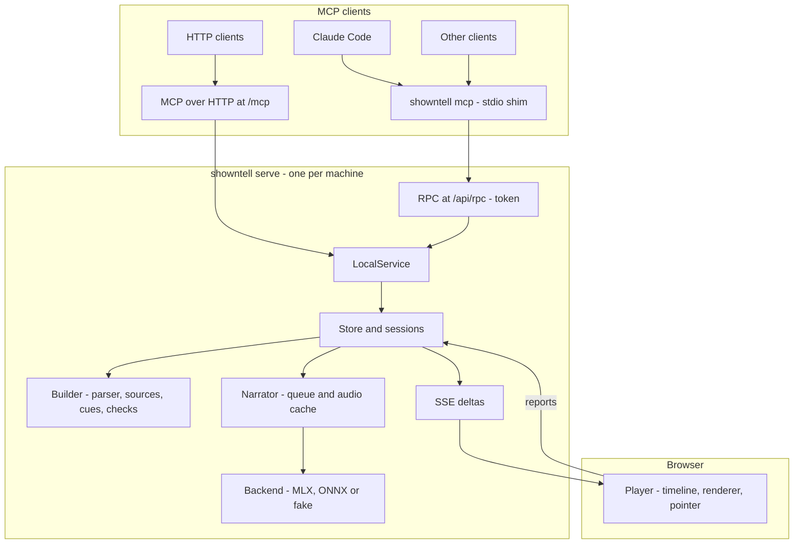
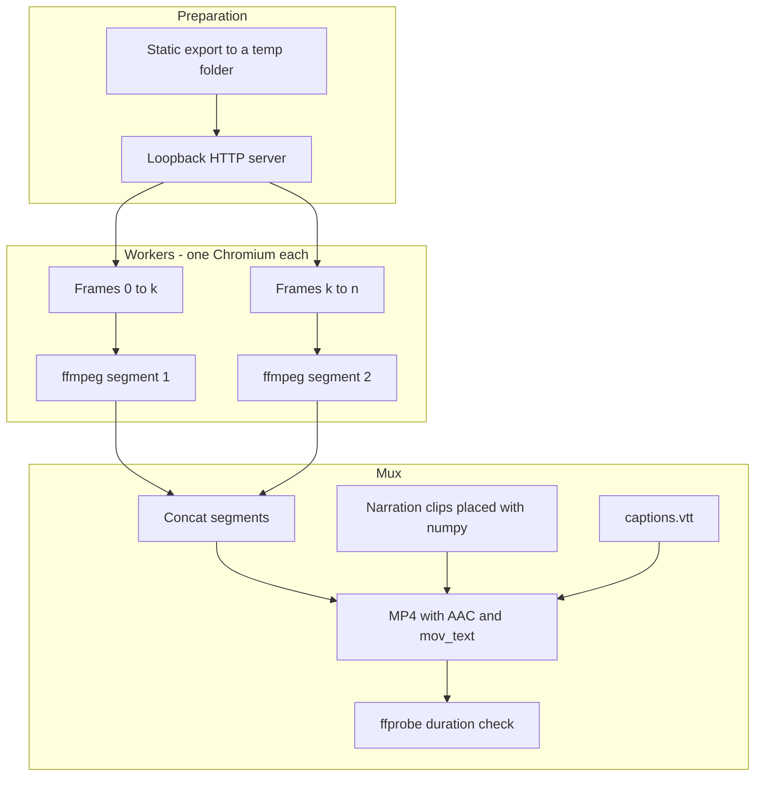

# Architecture

showntell is one Python package and one static web player. A long-lived daemon owns the voice model and the walkthroughs; MCP clients reach it either directly over HTTP or through a small stdio shim.

## Request path

1. **Shim:** `showntell mcp` reads `daemon.json` in the data folder. If no daemon of the same version is healthy, it starts `showntell serve` in the background and waits for `/health`. Its MCP tools forward to the daemon's RPC route with the token from the lockfile.
2. **Service:** `LocalService` implements the tools. The MCP layer (`server.py`) formats replies, waits for the opening audio with progress notifications, and attaches the guide to the first playable reply.
3. **Builder:** `format.Parser` turns each chunk into blocks; the chunk end closes open blocks except fences. `build.Builder` turns blocks into slides, reads code from disk or git (`sources.py`), resolves and infers cues, and records problems (see **Builder** below).
4. **Narrator:** every narration paragraph becomes a speech job. `pronounce.speakable` rewrites code and units into speakable text with a character map back to the display text; the job key is a hash of model, voice, speed and spoken text. One worker thread voices jobs in order of their position in their walkthrough.
5. **Events:** each change marks slides as changed; the SSE route coalesces changes for 50 ms and sends only the changed slides plus the slide order.

## Builder

`build.Builder` holds the state of one walkthrough being written and mixes in two groups of methods kept in their own modules.

| Module | Holds |
|---|---|
| `build.py` | blocks to slides: headings, narration, shown text, code from disk, diffs, diagrams, images, tables, lists; dispatch of bundled kinds |
| `cues.py` | `CueResolver`: each cue target to a resolved cue (lines, item, row, node, edge path, image region, code step, whole visual), and cues inferred from names when narration has none |
| `checks.py` | `Checks`: size findings on code and diffs, findings on each finished slide (narration, cues, reading the screen, reveal order) and on the whole walkthrough (code runs, openings) |
| `mermaid.py` | node ids, labels and edges read from Mermaid source, for cues and edge paths |
| `icons.py` | the bundled Lucide icons: lookup by name, close names for an unknown one, `:name:` at the start of text |
| `kinds/` | one module per bundled kind (chart, stat, chat, terminal, tree, svg, drawio) and a registry by fence language and slide kind |

Each bundled kind is a `kinds.base.Kind`: its fence languages, a parser that returns the visual and problems, a size check, and how a cue names its parts. The builder, cue resolver and checks ask the registry instead of naming kinds, so a new kind is one Python module plus its player module, styles and catalogue entry (CONTRIBUTING.md lists them). A problem with a block goes back with the kind's `format` text from `text/kinds.json` as the fix.

## Player

`static/js/timeline.js` turns the walkthrough into segments (one per paragraph, with gaps) on a single clock and answers "what should be on screen at time *t*": slide, fired cues, step-reveal level and current word. `playback.js` advances the clock from the audio element while a paragraph plays and from wall time during gaps; `view.js` applies that state to the DOM, including slide transitions and the staggered arrival of cards, timed from the slide's start on the same clock. Seeking, live updates and export all go through the same function. The player is plain ES modules with no build step:

| Module | Role |
|---|---|
| **`timeline.js`** | the pure core: segments, `stateAt(t)`, step reveals, presenter steps; no DOM, tested with `node --test` |
| **`state.js`** | shared flags, DOM handles, mutable playback state (one object), finding reports and embed events; imports no other player module |
| **`playback.js`** | the clock: play, pause, seek, stalls while the writer or voice catches up, the wait for a slide to draw, ranges |
| **`view.js`** | the slide on screen: draws it, sizes it, reveals parts, switches code versions, runs per-frame animation, measures layout findings |
| **`pointer.js`** | where a cue points, the pointer marks and scrolling long code |
| **`camera.js`** | zooming onto a cue's target and back, by the narration clock: moves planned against the speech (`cameraPlan` in `timeline.js`), arcs, creep and breathing |
| **`decode.js`** | labels withheld by `{.decode}` cues: scrambled until their cue, then resolved |
| **`chrome.js`** | captions, transcript, chapters, progress bar, overlay and end card |
| **`present.js`** | presenter and audience windows, and commands from a page that embeds the player |
| **`main.js`** | loads the walkthrough, follows live updates, wires the controls, capture mode |
| **`render.js`** | the slide skeleton and the registry of slide kinds |
| **`kinds/*.js`** | one module per slide kind (`code`, `diff`, `list`, `table`, `diagram`, `math`, `image`, `chart`, `stat`, `chat`, `terminal`, `tree`, `svg`, `drawio`, `title` with chapter cards) |
| **`draw.js`, `diff.js`, `util.js`** | DOM helpers shared by kinds (`fit`, highlighting, text ranges), the line and word diff, escaping and inline Markdown |
| **`deco.js`** | icons copied into a slide, and the motif behind title slides |

A kind module's default export has `render(slide, body, parts, ctx)`, which draws the visual and registers the parts cues point at (`lines`, `items`, `rows`, `svg`), and optional hooks: `layout` (size once drawn; default `fit`), `reveal` (step reveals other than items, rows and lines), `target` (where a cue of its own kind points), `frame` (per-frame animation such as counting numbers or a travelling dot) and `measure` (its own layout findings). Items with ids reveal, point and highlight without a hook, so a new kind is usually one module plus its CSS.

## Findings

Every check, on the server or in the player, produces an `issues.Issue`: a stable code from `issues.CODES`, a severity, the slide, the Markdown line, the message and a fix. Builder findings are returned on the call that caused them. Timing findings (`still_slide`) need audio, so they wait in the session and go out with the next call. The open player posts its findings (layout measured after a slide settles, render and audio errors, waits) to `/w/<id>/report` with the walkthrough's report key; only player codes are accepted from it, and its messages reach the agent marked as untrusted. `server.py` orders replies by severity and folds repeats.

## Themes

`static/themes.css` defines every colour as a token, once per theme; `player.css` uses only tokens, and a test keeps raw colours out of it. The page carries the walkthrough's theme on `<html data-theme>` and a project's checked overrides as inline custom properties; a small script in the page head applies the viewer's choice before first paint. Mermaid reads the tokens when it starts.

## Embedding and presenting

When the player runs inside an iframe it posts its events to the parent (`ready`, `slidechange`, `timeupdate`, `durationchange`, `waiting`, `ended`, `playbackerror`) and takes `play`, `pause` and `seek` messages; `static/embed.js` wraps that in a custom element. Presenter mode (`?present=1`) never starts the clock: each key press seeks to the next step from `timeline.steps`, and a `BroadcastChannel` named after the walkthrough keeps an audience window on the same time.

## Capture and video export

`capture.py` opens the player with `?capture=1`. In that mode the player plays no audio, turns CSS animation and transitions off, shows only the stage at scale 1, and exposes `window.__showntell.duration()` and `seek(t)`. `seek` resolves once the frame for *t* is painted (slide renderers, Mermaid, KaTeX, images and fonts settled, then two animation frames) and returns a state key built from slide, revision, reveal level, cue and, with burned captions, the current word. Equal keys mean equal pictures.

| Step | How |
|---|---|
| **Page size** | the browser window is the frame's own size (1280x720 for landscape); the device pixel ratio scales it to the output size, so text stays sharp |
| **Frames** | each worker seeks frame *i* to *i*/fps, screenshots only when the state key changes, and pipes the image into its ffmpeg (image2pipe, x264) |
| **Sound** | clips from the exported `audio/` folder, placed at their start on the timeline that `export.timeline` shares with `timeline.js` |
| **Join** | segments concatenated without re-encoding; one metadata tag, the encoder, names showntell and its version |
| **Check** | the player's and exporter's timeline lengths must agree within 0.05 s, and the file's duration the timeline's within 0.2 s |

The same module writes `poster.png` for folder exports and returns PNG frames at any times for other callers (`capture_frames`).

## Single-page export

`export_html` in `export.py` writes the folder export to a temporary directory, then folds it into one HTML file that opens from disk with no server:

| Part | How it travels |
|---|---|
| **Player modules** | each `static/js` module as a `data:` URL in an import map, its relative imports rewritten to bare `showntell/js/...` specifiers; a page opened from `file://` cannot fetch module files but can import `data:` URLs |
| **CSS** | `themes.css` and `player.css` inline; KaTeX's stylesheet carries its woff2 fonts as `data:` URLs |
| **Walkthrough** | `data.json` in a `<script type="application/json">` at the end of the page; narration MP3s and images inside it as `data:` URLs, turned into `blob:` URLs before the player starts |
| **Libraries** | only those the slide kinds need (Mermaid for diagrams, KaTeX for formulas, highlight.js for code), in a registry `loadScript` and `loadCss` read before the network; scripts over 100 KB gzipped and unpacked with `DecompressionStream` |

## Data

| Path in the data folder | Contents |
|---|---|
| `daemon.json` | pid, port, version and RPC token of the running daemon (mode 0600) |
| `daemon.log` | daemon log when started in the background |
| `walkthroughs/<id>/state.json` | the walkthrough: slides, narration, cues, timings |
| `walkthroughs/<id>/source.md` | the Markdown as received |
| `walkthroughs/<id>/assets/` | images copied from the project |
| `walkthroughs/<id>/exports/` | hosted mode: MP4 and page exports, for the owner to download |
| `dev-logins.json` | hosted mode trials: the stub login's tokens (mode 0600) |
| `auth.db` | hosted mode sign-in: users, MCP clients, codes, tokens and browser sessions, secrets hashed (mode 0600) |
| `audio/<key>.wav` and `.json` | voiced narration and its word timings, shared by all walkthroughs |
| `models/` | the spaCy English model |
| `lexicon.txt` | your pronunciations, `word = spoken form` |

Voice models live in the Hugging Face cache (`~/.cache/huggingface`).

## Hosted mode

With `SHOWNTELL_MODE=hosted` one server serves several people (docs/hosted-design.md). `hosted.check_config` refuses unsafe settings at start; `hosted.HostedGuard` replaces `Guard` and resolves each request to a user through `identity.Identity` (bearer token on `/mcp`, session cookie on pages); `access.py` decides who may view or change a walkthrough. The store, service and routes take that user and check it; in local mode they get none and check nothing. Agent-facing differences live in `text/hosted/`.

| Module | Holds |
|---|---|
| `identity.py` | `User`, browser sessions with CSRF tokens, the `Login` seam and the phase 1 stub login |
| `access.py` | owner, shared viewer, or nobody |
| `hosted.py` | startup checks, the CSP, the guard, the rate limiter, and `Hosted`: limits, identity and the internal URL the server's Chromium uses |
| `oidc.py` | the provider presets, discovery, the code exchange, ID token checks and the rule for who may sign in |
| `signin.py` | `OIDCLogin`: `/login`, `/oidc/callback`, `/logout` and the consent page |
| `oauth.py` | `AuthServer`, the provider behind the MCP SDK's authorize, token, registration and revocation handlers; both metadata documents; client ID metadata documents |
| `authdb.py` | `auth.db`: users, registered clients, pending sign-ins, codes, tokens and sessions, every secret hashed |

