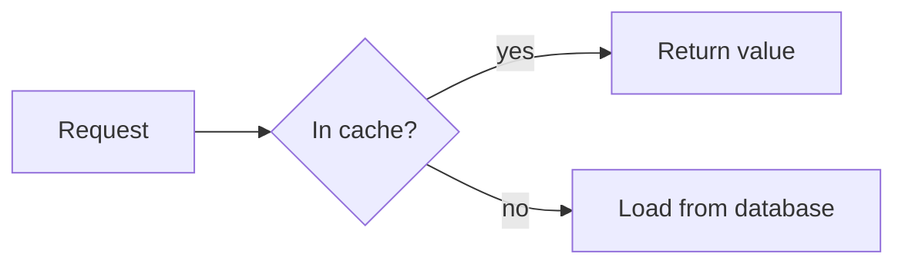

# showntell format, version 1

A walkthrough is a Markdown document. Headings start slides, fenced blocks and lists are what the viewer sees, and plain paragraphs are what the narrator says. Links inside narration move the pointer.

````markdown
# How the cache lookup works
> A read-through cache in sixty lines

Every request checks a small in-memory cache before it touches the database.

## The lookup {#lookup}

```python file=src/cache.py lines=10-24
```

The method starts by [checking the dictionary](#L12 "if key in self._data").
On a miss it [calls the loader](#L18) and stores the result.
````

## Document

| Part | Rule |
|---|---|
| **Front matter** | optional, only at the very start, between `---` lines. Keys: `title`, `description`, `frame`, `theme`, `voice`, `speed`. Tools pass these as arguments instead. |
| **Slide** | every heading (`#`, `##` or `###`) starts a slide. The level does not matter. |
| **Title slide** | the first slide renders as a title slide when it has no visual. A `>` quote under it is the subtitle. |
| **Visual** | one per slide (two on a `.pair` slide): a code block, a diff, a diagram, a formula, a table, a list, an image, a chart, headline numbers (`stat`), an exchange (`chat`), a terminal session, a file tree, a drawing (`svg`) or a draw.io diagram |
| **Shown text** | `>` quote lines are shown on the slide, never spoken: under a heading with a visual, a takeaway line; on a `.side` slide, takeaways beside the visual; on a slide with no visual, one large statement |
| **Narration** | every other paragraph is spoken. Each paragraph is voiced separately, with a short pause after it. A paragraph that starts with `1. ` or `- ` right after the slide's visual is spoken too, since a list there would be a second visual. |
| **Questions** | a slide whose heading has the `.questions` class is not shown; its list items become the questions offered at the end. Questions passed to `finish_walkthrough` replace them. |

Text before the first heading belongs to an automatic title slide that uses the walkthrough's title.

## Heading attributes

A heading may end with attributes in braces: `## The lookup {#lookup .build}`.

| Attribute | Meaning |
|---|---|
| **`#id`** | the slide's id, used to revise it later. Letters, digits, `-` and `_`. Generated from the title when missing. |
| **`.cards`** | show a list as a grid of cards |
| **`.timeline`** | show a list of dated events on a timeline |
| **`.steps`** | show a list as numbered steps (same as writing `1.` items) |
| **`.quiz`** | show a `- [ ]` / `- [x]` list as a multiple-choice question |
| **`.build`** | step reveal: parts appear as narration points at them |
| **`.side`** | the visual with the slide's `>` lines beside it as takeaways |
| **`.pair`** | two visuals side by side |
| **`.full`** | the visual edge to edge, the title small in a corner |
| **`.morph`** | a drawing that starts as the previous slide's drawing and glides into its own |
| **`icon=name`** | an icon on a title, chapter or statement slide |
| **`.questions`** | the end-of-walkthrough questions, not a slide |
| **`alt="..."`** | text alternative for a diagram or image |
| **`voice=`, `speed=`** | reserved: per-slide voice and speed |

## Layouts

| Layout | Shows |
|---|---|
| **default** | the title, an optional `>` takeaway under it, and the visual filling the rest |
| **`.side`** | the visual on the left and the slide's `>` lines on the right, one card per line, each numbered or led by its icon; below the visual in portrait |
| **`.pair`** | two visuals under one heading, side by side (stacked in portrait); each is written as usual, one after the other |
| **`.full`** | the visual over the whole slide, the title and takeaway in a small panel in the top corner |
| **statement** | a slide with no visual: its first `>` line as one large sentence, the heading as a kicker above it (the heading alone when there is no `>` line), and further `>` lines smaller below |

On a `.pair` slide a cue points into the first visual when it has the target, else into the second; give the two visuals different ids. Quoted text (`[label](# "text")`) is looked for in both. `.build` does not apply to a pair, and only the first visual may have `step` versions.

Every content slide has a kicker above its title: its number among the content slides and the part it belongs to. Slides come in by the narration's clock, so seeking and MP4 export show the same motion. A slide starts coming in about half a second before its first word, so the change has landed as the word is heard: it rises in, a slide that shows the same kind of visual in the same layout as the one before slides across like a page, title and chapter slides zoom in, and cards, numbers, rows, messages and takeaways arrive one after another, a tenth of a second apart (except on `.build` slides). A still drawing breathes, about 1% in and out (in the player; MP4 export holds it still unless `--motion` is given).

## Icons

The [Lucide](https://lucide.dev) set (ISC) is bundled. An icon is named:

| Where | How |
|---|---|
| **List item or card** | `- :database: **Postgres**: durable store` |
| **Number** | `:clock: p95 latency: 420 ms` in a `stat` block |
| **Takeaway** | `> :zap: Reads skip the database` |
| **Title, chapter, statement** | `## Storage {.chapter icon=database}` |
| **Drawing** | `<use href="icon:cloud" x="40" y="40" width="64"/>` (see Drawing) |

The builder copies each icon into the slide that uses it. An unknown name is reported as `icon_unknown` with close names and left out.

## Visuals

### Code

````markdown
```python
def get(self, key):
    ...
```
````

The info string after the language may hold options:

| Option | Meaning |
|---|---|
| **`file=path`** | read the code from this file in the project. Leave the block body empty. |
| **`lines=10-24`** | with `file=`: the line range to show |
| **`start=10`** | number the first line 10 when the code is written inline |
| **`title="..."`** | caption above the code; defaults to the file name |

Line numbers in the gutter are the file's own line numbers, and cues use the same numbers.

**Long code:** `scroll` in the info string (```` ```python file=src/app.py lines=1-200 scroll ````) keeps the code at reading size, however long (up to 400 lines), shows as much as fits, scrolls so the latest cued range sits in the middle, and dims the other lines.

**Reading size:** code is never shrunk to fit its longest line. A line too long for the reading size wraps, its continuation indented under the line's own indentation, so code text gets small only when a block has too many lines (`text_too_small`, whose message gives the line count and a target). The limits under Frames and limits still apply: wrapped lines are readable, but read worse than a narrow excerpt (`code_too_wide`).

**Code that evolves:** consecutive code blocks marked `step` become versions of one piece of code on one slide. `#step-2` moves to the second version: lines that stay glide to their new place and new lines fade in. Line cues after a step cue count lines in that version.

````markdown
```python step
def total(xs):
    t = 0
    for x in xs:
        t += x
    return t
```
```python step
def total(xs):
    return sum(xs)
```

The loop [adds each value](#L4). It then [collapses into one call](#step-2), where [sum](#L2 "sum") does the work.
````

### Diff

Three ways to show a change side by side:

````markdown
```python old
total = 0
for x in xs: total += x
```
```python new
total = sum(xs)
```
````

````markdown
```diff
-total = 0
-for x in xs: total += x
+total = sum(xs)
```
````

````markdown
```diff file=src/stats.py rev=HEAD~1
```
````

With `file=` and `rev=`, the server reads both versions from git: `rev=A` compares commit `A` with the working tree, `rev=A..B` compares two commits, and `rev=A...B` compares `B` with the commit where it branched from `A`, as a pull request does. It shows the changed region with a few lines of context; `lines=` narrows the new side to that range instead. A pasted `diff` block is numbered from its first `@@` header, so send one hunk per slide.

The two sides sit next to each other, or stacked in portrait. A diff too wide to show side by side at reading size stacks its panes, before above after, and lines still too long wrap as code does (`diff_too_wide` warns of both).

### Diagram

````markdown

````

Any Mermaid diagram type works. Give each node a short id so narration can point at it.

### Formula

````markdown
```math
\mathrm{softmax}(z)_i = \frac{e^{z_i}}{\sum_j e^{z_j}}
```
````

A `$$ ... $$` block works too. The content is LaTeX rendered with KaTeX.

### Table

A GitHub-style pipe table. Cells may hold inline code and emphasis. Rows are `#row-1`, `#row-2` and so on for cues; a row with a cell ending in `{#id}` (normally the last) also answers to that id.

### List

```markdown
- **Memory**: fast, gone on restart {#memory}
- **Disk**: survives restarts {#disk}
```

Bullets give a bulleted list and `1.` items give numbered steps; add `.cards` to the heading for cards, `.stack` for layers drawn as a stack (top item on top), or `.timeline` for dated events: each item's bold title is its date (`- **1989**: the first proposal`), drawn on a line across a landscape slide and down a square or portrait one, or any slide with more than six dates. Items starting with `[x]` or `[ ]` make a checklist: a ticked item's tick draws in when narration points at it, or at once if the slide has no item cues; `[ ]` stays empty. An item may start with a bold title, followed by `:` or a dash and a description. A trailing `{#id}` names the item for cues; without one, the id is the title in lowercase with hyphens (`**Hot path**` becomes `#hot-path`). Nested lists are flattened.

### Quiz

````markdown
## Which call retries? {.quiz}

- [ ] `fetch`
- [x] `send`
- [ ] `close`

Which of these retries a failed request?

{pause=3}

It's [B](#b), `send`. `fetch` makes the request, but it hands a failure straight back.
````

`.quiz` on the heading turns a checklist into a multiple-choice question: two to four choices, exactly one marked `[x]` (otherwise `quiz_shape`). Choices are lettered A, B, C, D on the slide and their ids are `a`, `b`, `c`, `d`, unless an item ends in its own `{#id}`. A viewer can click a choice to commit to it.

The answer shows (the right choice turns green, the others dim, a wrong pick is marked) when a written cue points at the right choice. Cues inferred from narration that reads the choices aloud do not show it. If no cue ever points at it, it shows when the slide's narration ends. A `{pause=3}` paragraph between the question and the answer is thinking time, shown as a bar running down under the choices. `quiz_reveal` reports an answer never pointed at, or pointed at in the first paragraph, while the question is being asked.

### Image

```markdown

```

A path is read from the project folder and copied into the walkthrough. An `https://` URL is shown as is.

`{frame=browser url="shop.example.com"}` after the image draws it in browser chrome with that address; `frame=window` and `frame=phone` work too. A cue can point at part of the picture with `#@left,top,width,height`, in percent of the picture: `[the search box](#@5,17,54,8)`.

A picture that no cue points into slowly pushes in while the slide plays; one with region cues holds still, so the pointer stays on its box.

### Chart

````markdown
```chart bar title="p95 latency" unit="ms"
series: before, after
read: 420, 180
write: 610, 390
```
````

| Type | Body | Cue targets |
|---|---|---|
| **`bar`** | one `label: value` line per bar; for grouped bars a `series: a, b` line first, then `label: 1, 2` | `#label`: the bar's label, lowercased with hyphens |
| **`hbar`** | as `bar`, one series, drawn horizontally for long labels | `#label` |
| **`line`** | an `x: …` line first, then one `name: v1, v2, …` line per series with as many values as x values | `#name`: the series |

Options: `title=`, `unit=` (shown after values), `x=` and `y=` (axis labels). Values may carry a unit suffix such as `ms` or `%`. At most 12 bars or series read well. The player draws the chart in the theme's colours: bars grow from the axis one after another and lines draw left to right as the slide arrives, then values and callouts appear.

A `note` line adds a callout: `note 400: tail grows here` at that x value (every series), `note p99/400: …` on one series, or `note write: …` above a bar. Cue notes as `#note-1`, `#note-2` in the order written.

### Numbers

````markdown
```stat
p95 latency: 420 ms -> 180 ms
error rate: 2.1% -> 0.3%
```
````

One to four big numbers, each `label: value` or `label: before -> after`; values may carry a unit, or `unit=` sets one for all. Each number counts from its first value to its last when narration points at it (`#p95-latency`), or at the start of the slide if no cue names a number.

### Exchange

````markdown
```chat
user: How do I undo my last commit?
assistant: Run `git reset --soft HEAD~1`.
  Your changes stay staged.
```
````

One message per `name: text` line; indented lines continue the message above. A user, client or browser sits on the right; otherwise the first speaker is on the left and the second on the right. Cue messages as `#m1`, `#m2` in order. At most 8 messages read well. `exchange` works as the name too.

### Chapter card

A heading with `.chapter` is a card that opens a part of the walkthrough, numbered Part 1, Part 2 and so on, with an optional `>` line under it. It needs no narration.

### Terminal session

````markdown
```terminal
$ uv run pytest -q
720 passed in 51.2s
```
````

Lines starting with a prompt (`$`, `%` or `>`) are commands; the rest is output. `console` and `shell-session` work as names too. Cues point at lines with `#L3`, counting from 1 with output lines included; `start=` changes the first number. Size limits are those of code.

### File tree

````markdown
```tree
src/
  app.py   # entry point
  cache/
    lru.py
tests/
```
````

One entry per line, nested by indentation (any consistent step) or pasted from the `tree` command. A trailing `/`, or deeper lines below, mark a folder; `# note` after an entry shows a short note. Cues point at an entry by its path (`#src/cache/lru.py`) or by a file or folder name that is unique in the tree (`#lru.py`).

### Drawing

````markdown
```svg
<svg viewBox="0 0 1150 560">
  <g id="sun"><title>Sun</title><circle cx="130" cy="130" r="64" fill="#ffd166"/></g>
  <path id="beam" d="M200 150 L560 260" stroke="var(--fg)" stroke-width="6" fill="none"/>
  <text id="eye" x="400" y="490" font-size="28" fill="var(--fg)">your eye</text>
</svg>
```
````

One `<svg>` with a `viewBox` (or a width and height), written inline, or read from the project with ```` ```svg file=docs/flow.svg ```` and an empty body, which also shows SVG exported from draw.io, Excalidraw or Inkscape. The drawing fills the slide body, scaled to fit; a viewBox of the body's shape fills it best: `0 0 1150 560` landscape, `0 0 860 800` square, `0 0 640 1080` portrait.

The builder rebuilds the drawing from an allowlist of SVG elements and attributes: shapes, paths, text, groups, `use`, gradients, patterns, markers, clip paths, masks, filters, `<style>` rules and embedded fonts and images (`data:` only). Scripts, event handlers, links and references outside the drawing, `foreignObject` and SMIL animation are removed and reported as `svg_removed`. The player draws it in a shadow root, so its `<style>` rules apply only inside it. Theme colours are available as `var(--fg)`, `var(--muted)`, `var(--accent)` and the other tokens in `static/themes.css`.

**Icons.** `<use href="icon:name" x="…" y="…" width="…"/>` becomes a group drawing that Lucide icon, 24 units square scaled to `width` (or `height`), stroked with the text colour unless it sets `stroke`. Its `id`, `class` and `<title>` stay, so cues and reveals reach it.

**Across slides.** `.morph` on a slide whose drawing follows another slide's drawing starts it as the previous slide's (its last version) and glides into its own as the slide begins, by the rules of drawings that change.

Cues point at any element by its `id`, by its `<title>` or own text, or by that text's slug; at a region with `#@left,top,width,height` in percent of the drawing; or at drawn text with `[label](# "text")`. With `.build`, the outermost elements with ids are the parts that appear in source order; a cue at an element inside one reveals that part, and unfilled strokes in a part draw themselves in.

**Drawings that change.** Consecutive ```` ```svg step ```` blocks are versions of one drawing. A `#step-2` cue moves to version 2: elements that keep their `id` glide from where they were over about 1.2 s (numbers in attributes move, also inside a `transform`, path or point list written the same way in both versions; colours blend; anything else switches halfway), elements new in this version fade in and those it dropped fade out. The glide follows the narration's clock, so seeking and MP4 export show the same in-between pictures. To move something along a circle, rotate a group around the centre (`transform="rotate(-90 575 280)"`) rather than changing its x and y.

**Hand-drawn.** ```` ```svg sketch ```` redraws every shape with Rough.js, as on a whiteboard: wobbly outlines, hatched fills (solid for small shapes), dashes kept, and text in the Virgil hand-drawn face. Shapes with a gradient fill stay as drawn. It combines with `step`.

**Checked.** The player reports text too small to read on the slide and labels that a line runs through or that sit on another label (`drawing_overlap`).

### draw.io diagram

````markdown
```drawio file=docs/architecture.drawio page="Overview"
```
````

A page of a draw.io file (`.drawio`, plain or compressed, or a `.drawio.svg` export, which carries its diagram), drawn by the official draw.io viewer. The viewer (`static/vendor/drawio`, Apache-2.0, about 4.3 MB) loads only when a slide needs it and never reaches the network. `page=` picks a page by name or number (from 1); the first page is the default. The diagram sits on a white page, as drawn in draw.io, scaled to fit the slide.

The builder rebuilds the page from cells, styles, geometry and labels. Labels keep simple formatting (bold, italics, line breaks, lists, tables, colours); links, tooltips, placeholders, web fonts, images that are not embedded, and maths are dropped. Shapes from icon libraries the viewer loads on demand (AWS, Azure, GCP, Cisco and similar stencils) are not bundled and show as their plain fallback.

Cues point at a cell by its id, or by its label or the label's slug when that is unique (`#api`, `#Postgres`, `#api-server`); at a region with `#@left,top,width,height` in percent of the diagram; or at label text with `[label](# "text")`. With `.build`, the shapes directly on a layer appear in source order; a cue at a shape inside a container reveals the container, and an edge appears once both its ends are shown. More than 400 shapes and connectors is reported as `block_too_big`.

## Narration

Narration is plain prose written to be heard. Markdown inside it is used like this:

| Markup | Effect |
|---|---|
| **`` `code` ``** | read as code: `camelCase` and `snake_case` are split into words, symbols are spoken |
| **`**bold**`, `_italic_`** | shown in captions; no effect on the voice |
| **`[label](#target)`** | a cue: the pointer moves to the target as the label is spoken |
| **`[text]{say="spoken"}`** | shows `text` in captions and speaks `spoken` instead; `spoken` may be phonemes between slashes, as in `say="/kˈOkəɹO/"` |
| **`[^1]`** | reserved: citation, listed in the transcript and never read aloud |
| **`{pause=1.5}`** | a paragraph holding only this adds silence, in seconds (at most 5) |

## Cues

A cue is a Markdown link inside narration. The label is spoken normally. The player fires each cue 0.3 s before the label's first word is spoken, about the time the pointer takes to glide over, so it lands as the word is heard: link the words that name the target, no earlier.

| Target | Points at |
|---|---|
| **`#L12`** | line 12 of the slide's code |
| **`#L12-18`** | lines 12 to 18 |
| **`#-L5`** | line 5 of the old side of a diff |
| **`#+L7`**, **`#L7`** | line 7 of the new side of a diff |
| **`#id`** | a list item, card, quiz choice (`#a`, `#b`), diagram node, table row, chart bar or series, or file-tree entry with that id |
| **`#a->b->c`** | a flowchart path: a dot travels along those edges, one hop at a time |
| **`#A->>B`** | a message in a sequence diagram, from participant `A` to `B`: the pointer goes to its text (the first such message; quoted text picks another) |
| **`#@10,20,30,15`** | part of an image: left, top, width and height in percent |
| **`#step-2`** | the second version of code written as `step` blocks |
| **`#`** | the slide's whole visual |

A title in quotes narrows the target to that exact text: `[the guard](#L12 "if key in self._data")` highlights only that text on line 12. With `#` alone, the quoted text is searched for anywhere in the visual: `[the decision](# "In cache?")` points at the diagram node with that label.

Cues only point within the current slide.

A style after the link changes how the pointer looks: `[the guard](#L12){.circle}`.

| Style | Draws |
|---|---|
| **`.box`** | the default frame |
| **`.circle`** | a hand-drawn ring |
| **`.underline`** | a hand-drawn line underneath |
| **`.arrow`** | an arrow pointing at the target |
| **`.highlight`** | a marker stroke swept across the target, left to right; the previous one fades about a second later |
| **`.zoom`** | the camera moves onto the target and holds there until the next cue; combine with another style, as in `{.zoom .circle}` |
| **`.decode`** | the target's label shows scrambled from the start of the slide until the cue, then resolves left to right: for the answer the narration builds to. Works on a drawing part, a diagram node, a list item or a table row |

On one dense drawing, draw.io diagram or screenshot, zoom onto each part as the narration names it and end with a cue to `#`, which pulls the camera back to the whole: a run of readable close-ups instead of one picture too small to read. It works best on a drawing split into panels, two by two or three across, each under its own heading: a zoom onto one panel takes up the whole frame with no pointer box, while a small shared figure placed where the panels touch stays visible in each close-up.

The camera follows the speech, on the narration's clock:

- **Moving in** starts about 0.4 s into the sentence holding the cue and takes about 1.6 s, easing in and out with half its change in the middle quarter, so it settles as the cued word is heard. A cue early in its sentence gets a shorter move that lands a little late.
- **Between close-ups** at a similar zoom, the camera pulls back about 6% on the way: an arc, not a flat slide.
- **Pulling out** to the whole visual takes 1 s and is front-loaded, starting just before its word.
- **Holding** a close-up, the camera creeps about 2% further in, drifting slightly towards the picture's centre; the whole view of a drawing breathes about 1%. MP4 export leaves both out, so held frames repeat and render once; `showntell export --motion` keeps them.
- **The pointer** waits while the camera moves and appears on the new subject when it lands.
- **Reduced motion** (`prefers-reduced-motion`) cuts at each cue and holds still.

When narration has no cues at all, showntell infers some by matching its words against code identifiers, node labels and list titles.

## Step reveal

With `.build` on the heading, the slide starts mostly empty and fills in as the narration points:

| Visual | Behaviour |
|---|---|
| **List, cards, table** | items or rows appear up to the latest one pointed at by id |
| **Code** | lines appear up to the end of the latest line range pointed at |
| **Flowchart** | nodes appear in source order up to the latest node pointed at (an edge path counts its nodes); an edge draws itself in once both its ends are visible |
| **Chart, file tree, numbers, exchange** | bars, series, entries, numbers or messages appear in source order up to the latest one pointed at |
| **Terminal** | lines appear up to the end of the latest line range pointed at, as for code |
| **Drawing** | the outermost elements with ids appear in source order up to the latest one pointed at (or holding the element pointed at); unfilled strokes draw themselves in |
| **draw.io diagram** | shapes on a layer appear in source order up to the latest one pointed at (or holding the cell pointed at); an edge appears once both its ends are shown |

Everything is visible once the slide's narration ends.

## Frames and limits

| Frame | Size | Code lines | Code width | Diff lines per side | Diff width per side |
|---|---|---|---|---|---|
| **landscape** | 1280 × 720 | 18 | 90 | 18 | 46 |
| **square** | 960 × 960 | 26 | 68 | 22 | 32 |
| **portrait** | 720 × 1280 | 34 | 48 | 18 | 52 |

These are the sizes that still render at a comfortable reading size, measured with `scripts/measure_limits.py`. Code past them keeps its reading size: wider lines wrap and a diff too wide side by side stacks, and only more lines make it smaller. Diffs show the two sides next to each other in landscape and square, and stacked in portrait.

## Themes

| Theme | Look |
|---|---|
| **`dark`** | the default |
| **`light`** | white slides |
| **`paper`** | warm off-white slides |
| **`night`** | deep indigo, pink accent |
| **`ocean`** | deep teal, coral accent |
| **`studio`** | bright lavender-white, violet accent |
| **`contrast`** | black slides, white text, yellow pointer |

The walkthrough's theme comes from `start_walkthrough`'s `theme`, else front matter `theme:`, else the project's `showntell.theme.json`, else `dark`. Viewers can switch with `?theme=` or the player menu. A project file can also replace single colours:

```json
{ "theme": "light", "tokens": { "accent": "#0969da", "node-line": "#8250df" } }
```

Token names are those defined in `static/themes.css`; `c1` to `c6` are the palette that cards, numbers, takeaways, diagram shapes and charts take their colours from, and drawings may use as `var(--c1)` and so on. Values must be colours (`#rrggbb`, `rgb()`, `rgba()`); anything else is reported and ignored. Every built-in theme meets WCAG contrast for its text.

Text is set in Inter, titles in Bricolage Grotesque and code in JetBrains Mono, bundled with the player (OFL), so slides look the same on every machine and in MP4 export.

## Reserved for later versions

Pronunciation of other languages, citations, per-slide voice and speed, and scene animations. Parsers must ignore attributes and classes they do not know.
