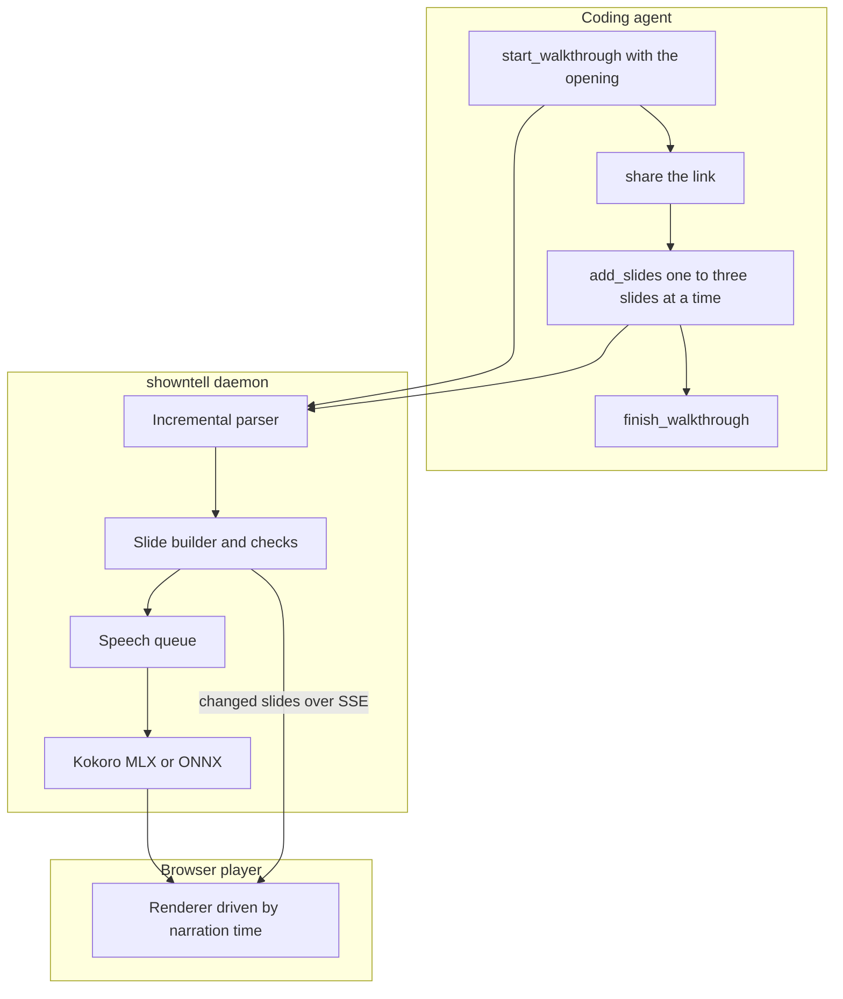

# showntell functional spec

This is the reference for how showntell behaves. The slide format is in [format.md](format.md).

## Flow

1. **Start with the opening:** `start_walkthrough` takes the title and, in `opening`, the title slide and one or two spoken sentences. It creates the walkthrough, voices the opening and returns when it is playable, about 0.3 s after the call arrives, with the handle, the link, an instruction to share the link now, and the full authoring guide. One model turn produces a shareable link.
2. **Or start, then open:** without `opening`, `start_walkthrough` returns the handle at once, and the first `add_slides` call carries the opening and returns the link the same way.
3. **Body:** the agent adds one to three slides per call. Each call returns at once with problems found in what it sent and anything the open player reported.
4. **Finish:** `finish_walkthrough` closes it, records the end questions, and returns a summary with remaining problems.

## Tools

| Tool | Arguments | Returns |
|---|---|---|
| **start_walkthrough** | `title`, `description`, `frame` (landscape, square, portrait), `theme` (dark, light, paper, night, ocean, studio, contrast), `voice`, `speed`, `project_dir`, `opening` | `handle`, `url`; with `opening`, the playable link and the guide |
| **add_slides** | `handle`, `markdown` | `status`, `url` once playable, `issues`, progress, the guide on the first playable reply |
| **revise_slide** | `handle`, `slide` (id), `markdown` (one slide) | `issues`; only changed narration is voiced again |
| **finish_walkthrough** | `handle`, `questions` (optional list) | summary, `issues`; with Playwright, findings from drawing every slide headless |
| **list_walkthroughs** | none | recent walkthroughs with handles, titles and links |
| **export_walkthrough** | `handle`, `format` (mp4, html), `path` (optional), `max_mb` (optional) | `path`, `bytes`, `duration_s`, `shrunk`; waits for the narration, then writes an MP4 (needs ffmpeg and Playwright) or one offline HTML page, by default in the project folder named after the title |
| **preview_slides** | `handle`, `slides` (optional ids) | a 640×360 picture of each slide fully revealed (up to twelve), plus layout findings from drawing them. Needs Playwright where showntell runs. |

**Delivery modes:** `showntell mcp --deliver file` (or `SHOWNTELL_DELIVER=file`) is for users who cannot open links on the agent's machine. The instructions, `start_walkthrough` and `finish_walkthrough` descriptions and the link-bearing replies come from `text/file/`: none hands the agent the link, and the flow ends with `export_walkthrough`, whose `max_mb` then defaults to 16. The mode belongs to each MCP connection, not the daemon.

All tools return structured content and a readable text version. Tools carry titles and annotations: `list_walkthroughs` is read-only, none destroy data, all work in a closed world.

**Prompts:** `diff`, `review`, `file` and `topic` return a ready-made request for a walkthrough of a change, a review of a change (verdict, one finding per slide, ranked findings), a file or a concept. Claude Code shows them as slash commands.

**Resources:** `showntell://walkthroughs` lists recent walkthroughs, `showntell://walkthroughs/{id}` holds one walkthrough's Markdown source, so a later session can read and revise it, and `showntell://slide-kinds` describes every kind of visual with an example.

## Project root

Code blocks with `file=` and images with a path read from the project root, which is the first of:

1. **Argument:** `project_dir` passed to `start_walkthrough`.
2. **MCP roots:** the first root the client reports.
3. **Shim directory:** the stdio shim's working directory. Claude Code starts stdio servers in the project folder.

When the client reports roots, `project_dir` must be one of them or inside one; otherwise `start_walkthrough` refuses it and names the roots. Roots are asked for mid-call on protocol versions up to 2025-11-25 and through an input-required round trip from 2026-07-28. Clients that report none keep the rules above.

Paths must stay inside the root after resolving symbolic links. Git runs only plumbing commands (`rev-parse`, `cat-file`) with fsmonitor disabled, and diffs are computed in Python, so a repository's diff drivers, filters and hooks never run.

## Document model

| Unit | Holds |
|---|---|
| **Walkthrough** | id (128-bit), write key, title, frame, voice, speed, project root, status, questions, Markdown source, format version, state version |
| **Slide** | stable id, revision, kind, title, classes (layout among them), visual data, a second visual on `.pair` slides, shown text, narration, the icons it uses |
| **Narration** | display text, spoken text, cues, audio file, duration, word timings, status |
| **Cue** | position in the display text, target, optional exact text, inferred flag, resolved time |

Audio files are named by a hash of model, voice, speed and spoken text and kept in one cache, so revising or replaying never voices the same text twice.

State is saved as JSON next to the source after each change (debounced) and reloaded on demand. Narration still waiting for audio after a restart is queued again.

While a player is connected, a revised slide replaces the old one only once all its narration has audio, so a revision never makes a viewer wait. The revised Markdown takes the old slide's place in the stored source, so the source (the `showntell://walkthroughs/{id}` resource and an export's `source.md`) always reads as the walkthrough now is.

## Speech

- **Backends:** one interface, two implementations. MLX (mlx-audio) on Apple silicon, ONNX Runtime elsewhere. Both run Kokoro-82M and share everything around the model: misaki for English phonemes (with espeak-ng for unknown words only when the `espeak` extra is installed), chunking, style vectors and per-word timings. From mlx-audio, showntell uses only the model loader and forward pass. On Apple silicon with `auto`, a failure to load MLX or voice a first sentence switches to ONNX; `/health` and `doctor` say why.
- **Queue:** one worker. Jobs are ordered by their position in their walkthrough, so the opening narration of a new walkthrough jumps ahead of a backlog.
- **Pronunciation:** narration is rewritten into speakable text before synthesis: identifiers are split, symbols, units, versions and paths are read aloud, and a user word list applies. A character map ties spoken words back to the display text, so captions and cues use what the agent wrote.
- **Timings:** each spoken token is located in the spoken text, then mapped to display offsets. A cue's time is the start time of the first word at or after its position; the player fires it 0.3 s earlier, so the pointer lands as the word is heard.

## Player

- **Data:** the full walkthrough on connect, then only changed slides over server-sent events. A static export reads the same JSON from a file; a single-page export carries it in the page, with narration and the player's fonts as data, the player's modules in an import map of `data:` URLs, and Mermaid, KaTeX (with its fonts) and highlight.js only when its slides use them, the large ones gzipped.
- **Time-driven:** every narration has a start time on one timeline, and the visible state (slide, revealed parts, pointer, highlighted entry, caption word) is computed from the current time. Playback, seeking and export all use that one function. Slide transitions (a rise, a push between alike slides, a zoom into title and chapter slides, a drawing gliding from the previous slide's) and the staggered arrival of cards, numbers and rows are driven by the same clock, so MP4 export shows them too.
- **Waiting:** when playback reaches narration without audio yet, it pauses and shows that the next slide is being written.
- **Reports:** render errors are posted back to the server with the per-walkthrough report key and reach the agent, marked as player reports, on its next call.

## Checks returned to the agent

Every reply lists findings in two forms. The text lists them one per line, errors first, at most twelve per reply and three per code, with the rest folded into a count. The structured content holds every finding as an object:

| Field | Meaning |
|---|---|
| **`code`** | stable identifier from the tables below |
| **`severity`** | `error` (content lost or misplaced), `warning` (will look or sound wrong), `info` (advice) |
| **`message`** | what is wrong, naming the slide |
| **`fix`** | what to do about it, when there is one thing to do |
| **`slide`**, **`line`** | where: the slide id and the Markdown line, when known |
| **`source`** | `player` for findings reported by the open player; absent for the server's own |

Findings from the server, found while parsing, building and voicing:

| Code | Severity | Catches |
|---|---|---|
| `source_error` | error | a file, line range or revision could not be read |
| `image_error` | error | an image is missing or not a type the player shows |
| `block_open` | warning | a code block is still open at the end of a call |
| `block_dropped` | error | a code block was never closed and was dropped |
| `front_matter` | warning | a front matter value is invalid and was ignored |
| `theme_file` | warning | the project's showntell.theme.json has a value that was ignored |
| `extra_visual` | warning | a slide got a second visual, which moved to a new slide |
| `old_without_new` | warning | an `old` block had no `new` block after it |
| `code_body_ignored` | info | a `file=` block had a body, which was ignored |
| `image_no_alt` | warning | an image has no alt text |
| `too_many_slides` | warning | the walkthrough is over the slide limit |
| `too_long` | warning | narration is past the length the guide aims for |
| `revise_kept_first` | warning | revise_slide got more than one slide and kept the first |
| `code_too_tall` | warning | code has more lines than the frame shows comfortably |
| `code_too_wide` | warning | code lines are wider than the frame shows comfortably |
| `diff_too_tall` | warning | a diff side has more lines than the frame shows comfortably |
| `diff_too_wide` | warning | diff lines are wider than the frame shows comfortably |
| `diff_hunks` | warning | a pasted diff has several hunks |
| `diagram_too_big` | warning | a diagram has more nodes than the frame shows comfortably |
| `generated_file` | info | a diff shows a lockfile or generated file |
| `block_error` | error | a line in a chart, stat or chat block could not be read and was left out |
| `block_too_big` | warning | a chart, stat or chat block has more parts than the frame shows comfortably |
| `tree_error` | warning | a file tree's nesting is inconsistent |
| `icon_unknown` | warning | an icon name is not in the bundled set and was left out |
| `svg_removed` | warning | a drawing had elements or attributes the player does not allow, which were removed |
| `cue_off_code` | error | a cue points at lines the slide does not show |
| `cue_no_target` | error | a cue names an item, row or node that does not exist |
| `cue_moved` | info | a cue's quoted text was found on another line and the cue moved there |
| `cue_text_missing` | warning | a cue's quoted text is not in the code |
| `cue_wrong_kind` | warning | a cue's target does not suit the slide's visual |
| `cue_no_visual` | warning | a cue is on a slide with no visual |
| `no_cues` | info | a slide with a visual has no cues |
| `zoom_unused` | info | narration names several parts of one picture without zooming onto them |
| `decode_unused` | info | a slide builds in order to a last part that could stay hidden until named |
| `build_cues_bunched` | info | a step-reveal slide fires all its cues in the first paragraph |
| `build_cue_order` | info | a step-reveal slide cues its parts out of source order |
| `no_narration` | warning | a slide has nothing to say |
| `thin_narration` | warning | a slide shows more than its narration gives time to read |
| `reads_screen` | warning | narration repeats on-screen text word for word |
| `same_openings` | info | several slides open with the same words |
| `opening_code_names` | info | the opening names code before saying what it is for |
| `spoken_handle` | warning | narration contains a handle, commit hash or URL the voice would read out |
| `still_slide` | warning | the screen does not change for a long stretch of narration |
| `code_run` | info | several code slides in a row with nothing showing behaviour |
| `plain_run` | info | several slides in a row are only lists, tables or text |
| `same_look` | warning | two slides in a row show the same kind of visual the same way |
| `no_takeaway` | warning | code, tables or formulas with no `>` line saying what to take from them |
| `layout_unused` | info | a layout class on a heading has nothing to lay out |
| `change_as_code` | info | a code slide talks about a change but shows one version of the code |
| `list_dates` | info | a list or table of dated events that a timeline would show |
| `table_numbers` | info | a table is mostly numbers a chart would compare at a glance |
| `stat_no_change` | warning | a stat shows a change that is not one: the same value, or every number from 0 |
| `narration_label` | warning | narration starts with a label such as Narration: that the voice reads aloud |
| `quiz_shape` | warning | a quiz does not have two to four choices with exactly one marked right |
| `quiz_reveal` | warning | a quiz's answer is never pointed at, or is pointed at while the question is asked |

`still_slide` needs audio, so it arrives with the first call after the slide is voiced. It fires when the screen holds still (no slide change, cue or reveal) for more than 20 s of narration.

`code_run` (four code or diff slides in a row) and `plain_run` (three list, table or text slides in a row) are checked as slides arrive, so the agent hears about a run while it can still break it; each run is reported once. `change_as_code`, `same_look` (the first two alike slides in a row) and `no_takeaway` (from the second dense slide without a `>` line) are reported once per walkthrough.

Findings from the open player, measured after a slide has settled. Their messages are untrusted text and are marked so:

| Code | Severity | Catches |
|---|---|---|
| `render_error` | error | a diagram, formula or image failed to render in the player |
| `audio_error` | error | narration audio failed to load or be voiced |
| `player_error` | error | the player hit a script error |
| `text_too_small` | warning | a visual's text renders below a comfortable reading size; code reaches it only with too many lines, since long lines wrap |
| `overflow` | warning | a visual still overflows the slide after shrinking |
| `pointer_offstage` | warning | a cue's target is outside the visible slide |
| `drawing_overlap` | warning | a line runs through a label in a drawing, or two labels overlap |
| `diagram_shape` | info | a flowchart's direction leaves it small in the slide's shape |
| `slow_render` | info | a slide took longer to draw than the player waits |
| `viewer_waited` | info | the viewer caught up with the writer and waited |

`finish_walkthrough` draws every slide fully revealed in headless Chromium (up to 60 slides, 25 s at most; `SHOWNTELL_FINISH_CHECK=0` turns it off), so render and layout findings reach the agent before it stops, not only when someone opens the link. The base install has no browser: then finish reports `no_browser` (warning), the reply carries no layout findings, pictures of alike slides or poster, and `showntell doctor` prints the two commands that add it (the `video` extra, then `playwright install chromium`). `not_checked` (info) covers the rest: the drawing failed or timed out, no player has opened the walkthrough, or some narration has no audio yet.

## Install and daemon

- **Commands:** `showntell mcp` (stdio server for MCP clients), `showntell serve` (the daemon), `showntell play FILE.md`, `showntell export`, `showntell doctor`, `showntell list`, `showntell prune`, `showntell stop`.
- **Shared daemon:** `showntell mcp` reads the lockfile in the data folder (pid, port, version, build id, build time, token). If the daemon is not running, it starts one in the background and waits for `/health`. If the daemon runs other code, it is replaced once idle when this copy is newer (a later version, or the same version with files written later); otherwise the newer daemon is used as it is, so two installs never replace each other in turn. `showntell stop` stops it.
- **Port:** 4747 by default; the next free port if that one is taken.
- **Direct HTTP:** MCP clients can also connect straight to `http://localhost:4747/mcp`.
- **First run:** downloads the Kokoro weights and the spaCy English model, with progress on stderr. `showntell doctor` checks models, port, voices and speech speed.

## Security

- **Loopback by default:** every route checks the Host header and, for POSTs, the Origin header. POSTs must be JSON.
- **Keys:** walkthrough ids are 128-bit. Writing needs the write key in the handle. Player reports need the report key embedded in the player page.
- **Untrusted reports:** player reports are passed to the agent marked as untrusted.
- **Beyond localhost:** binding to another interface requires an access token, added to every link.
